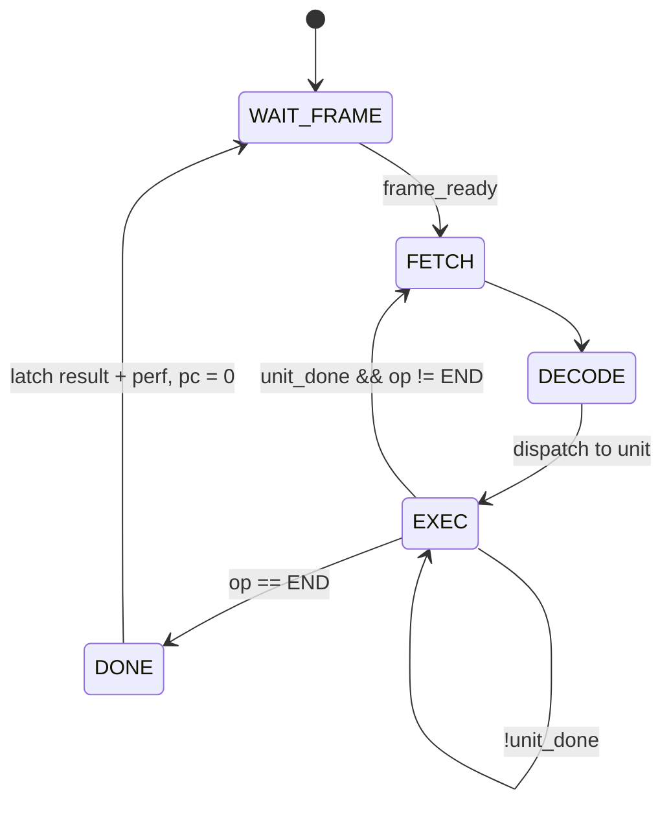
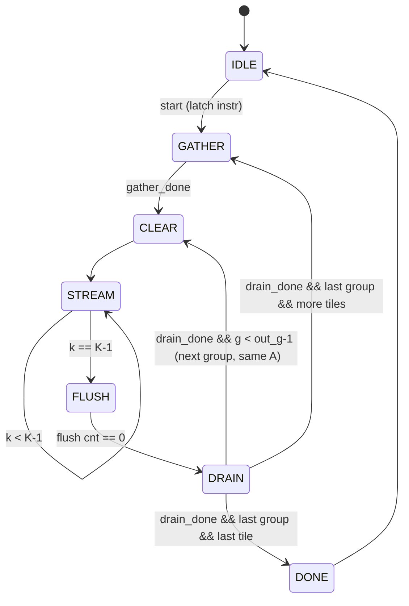

# Design Plan: Standalone Vision NPU (Tang Nano 20K)

**Created:** 2026-10-23
**Author:** GateFlow Planner
**Status:** Draft (supersedes `transformer_accel.md`)

## Overview

A small, instruction-driven INT8 neural-network accelerator ("mini NPU") plus
its compiler, deployed standalone on a Sipeed Tang Nano 20K (Gowin GW2AR-18).
A camera feeds live video into the FPGA, the NPU runs a quantized CNN on every
frame, and the result is drawn over the live video on an HDMI monitor. No PC is
needed at runtime; it's powered from USB.

| Stage | Model | Demo | Detail level |
|-------|-------|------|--------------|
| 1 | MNIST CNN (LeNet-style) | NPU in simulation, bit-exact vs TFLite | **Full** |
| 2 | Same model | Camera → NPU → HDMI shows "7" live | **Full** |
| 3 | MobileNetV1-0.25 person detection (Visual Wake Words) | Live "PERSON / NO PERSON", MLPerf Tiny-style numbers | Outline |
| 4 | Tiny ViT | Attention on the same NPU | Outline |

### Why it's built this way
- **Instruction-driven, not hardwired per model:** the same RTL runs any
  network the compiler can lower to the ISA. That's what makes it an NPU rather
  than a fixed-function circuit.
- **Fixed-function sequencer, no soft CPU (Stage 2):** a CNN is a static list of
  layers, so a small instruction sequencer is enough, easier to verify, and
  uses less of the chip than a RISC-V core. Revisit at Stage 4 if softmax/LayerNorm
  control gets complex.
- **Bit-exact with TensorFlow Lite:** INT8 semantics follow TFLite's reference
  kernels exactly, so every layer of every frame can be checked against a
  trusted golden model.
- **Simple first, then optimize with measurements:** v1 runs gather → compute
  → drain in sequence. Phase 8 overlaps them and reports before/after cycle
  counts. That measured story is the main portfolio point.

## Requirements

| # | Requirement |
|---|-------------|
| R1 | INT8 inference using TFLite semantics: symmetric per-channel weights, asymmetric activations (zero point), INT32 bias/accumulators, `MultiplyByQuantizedMultiplier` requantization |
| R2 | Every layer's output bit-exact vs the TFLite interpreter (reference kernels) and vs the NumPy ISA simulator |
| R3 | Ops (Stage 2): CONV (k×k, stride, pad; FC expressed as a CONV), MAXPOOL 2×2, LOAD_INPUT, ARGMAX, END |
| R4 | Live camera input (OV7670 over DVP), 28×28 center crop to the NPU every frame |
| R5 | HDMI 640×480@60 output: live preview, crop box, "what the NPU sees", predicted digit, latency |
| R6 | Runs standalone: model and program baked into the bitstream, no host link required |
| R7 | NPU latency < 1 camera frame (33 ms); target ≈ 2 ms at 25.2 MHz |
| R8 | Fits GW2AR-18: < 65% LUT, < 90% BSRAM (BSRAM is the tight resource) |
| R9 | Open-source flow only: Yosys → nextpnr-himbaechel → gowin_pack → openFPGALoader |
| R10 | Cycle counters per layer and per frame, readable for the performance write-up |

## Hardware

| Item | Notes |
|------|-------|
| Sipeed Tang Nano 20K | GW2AR-LV18QN88C8/I7: 20,736 LUT4, 15,552 FF, 46 BSRAM (18 Kbit), 48 DSP mults, 64 Mbit SDRAM in package, HDMI connector, 27 MHz crystal |
| OV7670 camera module (no FIFO) | DVP 8-bit, SCCB config, 3.3 V. About 15 pins on the GPIO headers. **Confirm pin availability with `/gf-pinmap` before buying.** |
| HDMI monitor + cable | 640×480@60 is universally supported |
| USB power bank | For standalone demos |

## Block Diagram

```mermaid
flowchart LR
    CAM[OV7670 camera]
    MON[HDMI monitor]

    subgraph FPGA[npu_board_top - Tang Nano 20K]
        direction LR
        subgraph CAMD["clk_cam domain (camera PCLK)"]
            SCCB[sccb_init<br/>register ROM]
            CAP[dvp_capture<br/>YUV → Y]
            DEC[preview_decim<br/>320×240 → 160×120]
            ROI[roi_downscale<br/>224×224 crop → 28×28<br/>invert, 8×8 box avg]
        end

        subgraph SYSD["clk_sys = clk_pix domain (25.2 MHz)"]
            FB[(preview FB<br/>160×120×8<br/>dual-clock)]
            INB[(input buffer<br/>2×784 B ping-pong<br/>dual-clock)]
            subgraph NPU[npu_core]
                SEQ[npu_sequencer<br/>instr ROM]
                GATH[npu_gather<br/>im2col + transpose]
                ABANK[(A banks<br/>8 × 2K×8)]
                WMEM[(weight mem<br/>2K × 64b)]
                PMEM[(param mem<br/>bias/M/shift)]
                SA[8×8 systolic array<br/>INT8 → INT32]
                RQ[npu_requant<br/>TFLite exact]
                WB[npu_writeback]
                AMEM[(activation mem<br/>2K × 64b)]
                POOL[npu_pool]
                AMAX[npu_argmax]
                PERF[perf counters]
            end
            VT[video_timing<br/>640×480@60]
            OVL[overlay<br/>preview ×3, crop box,<br/>digit glyph, latency]
            TMDS[tmds_encoder ×3]
        end
        SER["OSER10 serializers<br/>clk_tmds 126 MHz"]
        PLL[rPLL + CLKDIV]
    end

    CAM -->|PCLK, VSYNC, HREF, D7:0| CAP
    SCCB -->|SIOC/SIOD| CAM
    PLL -->|XCLK 25.2 MHz| CAM
    CAP --> DEC --> FB
    CAP --> ROI --> INB
    INB -->|LOAD_INPUT| AMEM
    SEQ --> GATH & SA & RQ & WB & POOL & AMAX
    AMEM --> GATH --> ABANK --> SA
    WMEM --> SA
    SA --> RQ
    PMEM --> RQ
    RQ --> WB --> AMEM
    AMEM <--> POOL
    AMEM --> AMAX
    AMAX -->|class, score| OVL
    PERF -->|cycles| OVL
    FB --> OVL
    INB -.->|display copy| OVL
    VT --> OVL --> TMDS --> SER --> MON
```

## Module Hierarchy

```
npu_board_top                    # Pins, clocks, resets, LEDs
├── clk_gen                      # rPLL 27→126 MHz, CLKDIV ÷5 → 25.2 MHz
├── reset_sync [per domain]      # POR + button, async assert / sync release
├── cam_subsystem                # clk_cam domain
│   ├── sccb_master              # I2C-like write-only master
│   ├── sccb_init                # OV7670 register table ROM + sequencer
│   ├── dvp_capture              # VSYNC/HREF/PCLK → (x, y, Y pixel)
│   ├── preview_decim            # 2×2 decimation → preview FB writes
│   └── roi_downscale            # Center 224×224 → 28×28, invert, box filter
├── dpram_dc [2]                 # Dual-clock BSRAM: preview FB, input buffer
├── npu_core                     # clk_sys domain, reusable, no board knowledge
│   ├── npu_sequencer            # Instruction fetch/decode/dispatch, frame trigger
│   ├── npu_tile_engine          # Per-layer loop nest: gather → compute → drain
│   │   ├── npu_gather           # im2col address gen, padding with zp, 8×8 transposer
│   │   ├── npu_abank [8]        # 2K×8 BSRAM, double-buffered halves
│   │   ├── npu_skew [2]         # Triangular input skew (A rows, B cols)
│   │   ├── npu_systolic_array   # 8×8 output-stationary
│   │   │   └── npu_pe [64]      # INT8×INT8 + INT32 accumulate
│   │   ├── npu_requant          # bias add, MultiplyByQuantizedMultiplier, zp, clamp
│   │   └── npu_writeback        # Pack 8 channels/pixel → 64-bit act-mem writes
│   ├── npu_pool                 # MAXPOOL 2×2 (AVGPOOL in Stage 3)
│   ├── npu_argmax               # Final-layer argmax → result register
│   ├── npu_load_input           # Input buffer → act mem (byte → channel-blocked)
│   ├── npu_mem [4]              # act, weight, param, instruction memories
│   └── npu_perf                 # Per-layer + per-frame cycle counters
└── video_subsystem              # clk_pix (= clk_sys) domain
    ├── video_timing             # 640×480@60 sync, active, x/y
    ├── overlay                  # Composites preview, crop box, NPU input, glyphs
    │   └── font_rom             # 8×8 glyphs (digits, a few letters)
    ├── tmds_encoder [3]         # DVI 8b/10b TMDS
    └── hdmi_phy                 # OSER10 + ELVDS_OBUF wrappers (Gowin primitives)
```

## Clocks, Reset, CDC

| Clock | Freq | Source | Used by |
|-------|------|--------|---------|
| clk_27 | 27 MHz | Crystal | rPLL input, POR |
| clk_tmds | 126 MHz | rPLL (27 × 14 / 3) | OSER10 serializers only |
| clk_sys = clk_pix | 25.2 MHz | CLKDIV ÷5 of clk_tmds | NPU, video, overlay |
| clk_cam | ~12.6 MHz | Camera PCLK (async) | Camera capture subsystem |
| XCLK (output) | 25.2 MHz | clk_pix forwarded | Camera master clock |

Running the NPU on the pixel clock in Stage 2 removes a clock domain. 25.2 MHz
is roughly 15× more NPU throughput than this model needs. Stage 3 adds a faster,
separate `clk_npu`.

| Crossing | From → To | Method |
|----------|-----------|--------|
| Preview pixels | cam → sys | Dual-clock BSRAM (tearing acceptable) |
| NPU input frame | cam → sys | Dual-clock ping-pong buffer + `frame_done` toggle, 2-FF synced, edge-detected → swap + start inference |
| Camera config done | cam → sys | 2-FF level sync |
| Reset | — | Per-domain reset synchronizer. The cam domain is held in reset until PCLK is running (PCLK only starts after SCCB config) |

The SCCB master runs in clk_sys and only drives slow I/O pins, so it crosses nothing.

## NPU Architecture

### Data layout
- **Activations:** channel-blocked HWC. One 64-bit word holds 8 channels of one
  pixel. Word address = `base + (y·W + x)·Cb + cb`, with `Cb = ⌈C/8⌉`. Padded
  channels hold arbitrary values and get zero weights.
- **Weights:** for output-channel group `g` (8 channels) and reduction index `k`,
  one 64-bit word = weights for those 8 output channels. Address = `w_base + g·K + k`.
  `k` iterates `(ky, kx, cb, c)`, which matches TFLite NHWC flatten order, so FC
  layers need no special reordering beyond the compiler's padding.
- **Params:** per output channel `{bias'[31:0], M[31:0], shift[5:0]}`, where
  `bias' = bias − in_zp·Σw` (the compiler folds the input zero point into the bias).

### Conv as GEMM on the 8×8 array (output-stationary)
- Array rows = 8 output pixels (consecutive in raster order), columns = 8
  output channels. PE(r,c) accumulates `Σ_k A[r][k]·W[k][c]` over `K = kh·kw·Cb·8`.
- **FC = CONV** with kernel = full input spatial size and 1×1 output
  (e.g. 7×7×16 → 10). Only row 0 is busy, which is acceptable at this size and
  goes in the utilization write-up.
- Loop nest per CONV instruction:
  ```
  for pixel_tile in ceil(out_h*out_w / 8):
      gather im2col patches for 8 pixels → A banks        # K cycles
      for g in out groups:                               # A reused across groups
          compute: stream k = 0..K-1 (A from banks, B from weight mem)
          drain: 64 accumulators → requant → writeback     # 64 cycles
  ```

### Gather (im2col) unit
- Reads one 64-bit act-mem word per cycle: 8 consecutive `k` values for one pixel.
  Out-of-bounds (padding) positions emit the input zero point in all 8 bytes.
- **8×8 byte transposer** (double-buffered, 2 × 64 B of registers): takes 8
  words (8 pixels × same 8 k-values) in, emits 8 cycles × (8 bytes, one per A bank).
- Throughput: 1 word in / 8 bytes out per cycle, so gathering K values for 8
  pixels takes ≈ K cycles.

### A banks
8 BSRAMs, 2048 × 8 b each. The two halves (1024 deep = K_MAX) form a double
buffer: gather fills one half while compute reads the other. v1 uses one half;
Phase 8 enables overlap.

### Systolic array
Reuses the earlier design: `npu_pe` with registered A (right), B (down), and valid
(along rows); `clear` zeros accumulators; INT8 × INT8 → 16 b, sign-extended
into INT32. Input skew = r stages for row r and c stages for column c.
`K_MAX = 1024` → `|acc| ≤ 1024·128·128 = 2²⁴`, so there's no overflow risk.

### Requantization (bit-exact TFLite)
Per result, pipelined at 1 per cycle:
```
x   = acc + bias'[c]
x   = SaturatingRoundingDoublingHighMul(x << max(shift,0), M[c])     // 32×32→64, keep high
x   = RoundingDivideByPOT(x, max(-shift,0))
y   = clamp(x + out_zp, act_min, act_max)                              // ReLU folded into act_min
```
About 4 DSP mults or a pipelined LUT multiplier. Verified against a NumPy port of
TFLite's `MultiplyByQuantizedMultiplier`, including saturation and negative-rounding edge cases.

### Memories (Stage 2)

| Memory | Size | BSRAM | Notes |
|--------|------|-------|-------|
| Preview FB | 160×120×8 b = 19.2 KB | 10 | Dual-clock. Fallback: 4 bpp → 5 |
| Input buffer | 2 × 784 B | 1 | Dual-clock ping-pong |
| Input display copy | 784 B | 1 | Lets the overlay show "what the NPU sees" without port contention |
| Activation mem | 2048 × 64 b = 16 KB | 8 | Peak use: 784 + 784 words (conv1 in/out) |
| Weight mem | 2048 × 64 b = 16 KB | 8 | LeNet needs ≈ 1,784 words. `$readmemh` init |
| Param mem | 256 × 70 b | 2 | `$readmemh` init |
| A banks | 8 × 2048 × 8 b | 8 | Double buffer included |
| Font ROM | 1 KB | 1 | |
| Instruction ROM | ≤ 32 × 128 b | 0 | LUT ROM |
| **Total** | | **39 / 46** | **BSRAM is the critical resource**. Stage 3 moves weights to SDRAM |

## Instruction Set (128-bit, little-endian fields)

| Opcode | Mnemonic | Fields |
|--------|----------|--------|
| 0x1 | CONV | in_base[11], out_base[11], w_base[11], p_base[8], in_h[7], in_w[7], in_cb[6], out_h[7], out_w[7], out_g[6], ksize[3], stride[2], pad[3], in_zp[8], out_zp[8], act_min[8], act_max[8] |
| 0x2 | MAXPOOL | in_base, out_base, in_h, in_w, cb, size[2], stride[2] |
| 0x3 | LOAD_INPUT | out_base, h, w, xor_mask[8] (0x80: uint8 → int8 with zp −128) |
| 0x4 | ARGMAX | in_base, count[10] → result register {class, score} |
| 0xF | END | Latch perf counters, signal `infer_done`, wait for next frame |
| (Stage 3) | DWCONV, AVGPOOL, WAIT_DMA | |
| (Stage 4) | GEMM_AA, SOFTMAX, LAYERNORM, GELU | |

The program runs once per `frame_ready`. Instructions execute strictly in order,
with no hazards to track.

### Stage 2 model program (MNIST, 28×28)

| # | Instr | In → Out | K | Out groups | Act-mem words |
|---|-------|----------|---|-----------|---------------|
| 0 | LOAD_INPUT | buffer → 28×28×1 (Cb=1) | — | — | 784 |
| 1 | CONV 3×3 s1 p1 + ReLU | 28×28×1 → 28×28×8 | 72 | 1 | 784 |
| 2 | MAXPOOL 2×2 | → 14×14×8 | — | — | 196 |
| 3 | CONV 3×3 s1 p1 + ReLU | 14×14×8 → 14×14×16 | 72 | 2 | 392 |
| 4 | MAXPOOL 2×2 | → 7×7×16 | — | — | 98 |
| 5 | CONV 7×7 p0 (= FC) | 7×7×16 → 1×1×10 | 784 | 2 | 2 |
| 6 | ARGMAX | 10 scores → class | — | — | — |
| 7 | END | | | | |

**Estimated v1 latency** (sequential, no overlap): ≈ 40 K cycles ≈ **1.6 ms @ 25.2 MHz**.
The model has ≈ 9.2 K params and ≈ 0.2 M MACs. The exact count is a Phase 4 deliverable.

## FSMs

### npu_sequencer


### npu_tile_engine (one CONV)

Phase 8 turns GATHER into a parallel process feeding the alternate A-bank half,
and adds shadow accumulators so DRAIN overlaps the next STREAM.

### sccb_init
`IDLE → RESET_WAIT (camera reset, ~1 ms) → WRITE (reg, val) → WAIT_ACKLESS → next entry → … → DONE`.
Writes about 80 registers from a ROM for QVGA YUV422, ~30 fps, PCLK ≈ XCLK/2.

## Video Pipeline
- **Camera:** QVGA 320×240 YUV422. `dvp_capture` keeps the Y bytes, giving 8-bit grayscale.
- **Preview:** 2×2 decimation → 160×120 FB. Shown at ×3 = 480×360 on the left of the 640×480 screen.
- **NPU input:** center 224×224 of QVGA → 8×8 box average → 28×28, inverted
  (dark ink on white paper → MNIST's white-on-black), written to the ping-pong
  buffer. Optional contrast stretch: min/max from the previous frame.
- **Overlay (right 160 px column):** NPU input at ×4 (112×112), predicted digit
  as a ×12 glyph, latency in µs from perf counters. Crop box drawn on the preview.
- **HDMI:** DVI-compatible TMDS (no audio or data islands), Gowin OSER10 10:1
  serializers on clk_tmds/clk_pix, ELVDS_OBUF outputs.

## Software

| File | Purpose |
|------|---------|
| `sw/model/train_mnist.py` | Keras CNN, augmentation (blur, thickness, shift, noise to mimic the camera), full-INT8 TFLite export |
| `sw/ref/tflite_ref.py` | Runs TFLite with **reference kernels** (`BUILTIN_REF`), dumps every intermediate tensor |
| `sw/ref/npu_sim.py` | NumPy instruction-level NPU simulator: same layout, same integer math as RTL |
| `sw/compiler/npu_compile.py` | `.tflite` → program/weights/params `.hex`, memory allocation, bias folding, padding, layout reorder |
| `sw/tools/frame_grab.py` | Optional: dump frames/activations over a debug UART for dataset collection and debugging |

**Three-way check:** TFLite (ref kernels) ≡ `npu_sim.py` ≡ RTL, per layer, bit-exact.

## Files to Create

| File | Agent | Phase |
|------|-------|-------|
| `sw/model/train_mnist.py`, `sw/ref/*.py`, `sw/compiler/npu_compile.py` | sv-developer | 1 |
| `docs/isa.md` | sv-developer | 1 |
| `rtl/npu/npu_pkg.sv` | sv-codegen | 1 |
| `rtl/npu/npu_pe.sv`, `npu_skew.sv`, `npu_systolic_array.sv` | sv-codegen | 2 |
| `rtl/npu/npu_requant.sv` | sv-codegen | 2 |
| `rtl/common/sdpram.sv`, `rtl/common/dpram_dc.sv`, `rtl/common/reset_sync.sv`, `rtl/common/sync_2ff.sv` | sv-codegen | 3 |
| `rtl/npu/npu_gather.sv`, `npu_abank.sv`, `npu_writeback.sv`, `npu_tile_engine.sv` | sv-codegen | 3 |
| `rtl/npu/npu_pool.sv`, `npu_argmax.sv`, `npu_load_input.sv`, `npu_perf.sv`, `npu_sequencer.sv`, `npu_core.sv` | sv-codegen | 4 |
| `rtl/video/video_timing.sv`, `tmds_encoder.sv`, `hdmi_phy.sv`, `overlay.sv`, `font_rom.sv` | sv-codegen | 5 |
| `rtl/camera/sccb_master.sv`, `sccb_init.sv`, `dvp_capture.sv`, `preview_decim.sv`, `roi_downscale.sv` | sv-codegen | 5 |
| `rtl/top/clk_gen.sv`, `npu_board_top.sv` | sv-codegen | 6 |
| `tb/` cocotb tests per module + `tb/Makefile` | sv-testbench | 1–6 |
| `tb/bfm/ov7670_bfm.py` (drives frames from images), `tb/bfm/hdmi_monitor.py` (decodes TMDS → image) | sv-testbench | 5 |
| `formal/*.sby` | sv-formal | 3–5 |
| `fpga/tangnano20k/npu.cst`, `fpga/tangnano20k/Makefile` | sv-pinmap / sv-synth | 0, 6 |
| `Makefile` (top: model, compile, lint, test, synth, flash) | — | 1 |
| `README.md` (block diagram, results, demo video) | — | 8 |

## Implementation Phases

### Phase 0: Spikes (de-risk the toolchain)
- Python env: TensorFlow + NumPy + cocotb in the project `.venv`
- Board, if available: blinky → HDMI 640×480 color bars (validates rPLL, CLKDIV,
  OSER10, ELVDS in the open flow) → BSRAM `$readmemh` init test
- **Done when:** color bars are on a monitor, or, with no board yet, the designs build through `gowin_pack`.

### Phase 1: Model, golden reference, ISA, compiler
- Train the MNIST CNN (≥ 98.5% INT8 test accuracy), export INT8 TFLite
- `npu_sim.py` matches TFLite ref kernels bit-exactly on all layers for 1,000 test images
- ISA document, compiler emits `.hex` images, `npu_pkg.sv` with ISA fields
- **Done when:** `make model && make compile && make sim-ref` passes.

### Phase 2: Compute datapath
- PE, skew, array, requant. cocotb vs NumPy, random plus edge cases
  (−128·−128, saturation in SRDHM, negative rounding, every shift value)
- **Done when:** array is bit-exact for K ∈ {1, 8, 72, 784, 1024}; requant matches on 10⁶ random vectors.

### Phase 3: Data movement
- Gather + transposer, A banks, writeback, tile engine. Formal: address bounds, transposer ordering
- **Done when:** a single CONV layer (conv1 and conv2 shapes) through the tile engine matches `npu_sim`.

### Phase 4: Full NPU
- Sequencer, pool, argmax, load_input, perf counters, `npu_core`
- **Done when:** the whole program runs in RTL sim from `.hex` images; all layers and
  final classes are bit-exact for 1,000 MNIST images; per-layer cycle report generated.

### Phase 5: Camera and video
- TMDS encoder (vs reference encoder model), video timing, overlay, HDMI PHY wrappers
- SCCB, DVP capture, decimation, ROI downscale, dual-clock buffers, CDC
- OV7670 BFM feeds images in; HDMI monitor model decodes the output to PNG
- **Done when:** in sim, a digit image in → decoded HDMI frame shows the preview, crop box and correct digit.

### Phase 6: Integration and synthesis
- `npu_board_top`, constraints, synth/PnR
- **Done when:** timing met at 25.2 / 126 MHz; LUT < 65%, BSRAM ≤ 41/46; full-system sim passes.

### Phase 7: Hardware bring-up
- Color bars → camera preview → NPU on a baked-in test image → live inference
- **Done when:** handwritten digits on paper are classified live on the monitor, running from a power bank.

### Phase 8: Performance and write-up
- Measure per-layer cycles and MAC utilization; enable A double-buffering,
  shadow accumulators, faster clock. Report before/after
- README: architecture, ISA, verification approach, resource and timing tables, roofline, demo video
- **Done when:** README published with measured numbers.

**Board needed only from Phase 0's hardware spike and Phase 7.** Phases 1–6 run in simulation.

## Verification Strategy

| Level | Method | Golden reference |
|-------|--------|------------------|
| Unit (PE, requant, transposer, TMDS, SCCB, …) | cocotb on Verilator, random + directed | NumPy models |
| Layer (tile engine) | cocotb, real layer shapes + random tensors | `npu_sim.py` |
| Network (npu_core) | cocotb, 1,000 MNIST images, every layer compared | `npu_sim.py` ≡ TFLite ref |
| System (board top) | OV7670 BFM → HDMI decoder → PNG + class check | Expected class |
| Hardware | Live digits, on-screen latency | Human eyes + perf counters |

### Formal (SymbiYosys)
| Property | Module |
|----------|--------|
| Act-mem / weight / A-bank addresses always in range | gather, tile_engine, writeback |
| Every CONV instruction terminates (bounded liveness) | tile_engine, sequencer |
| Transposer outputs each input byte exactly once, in order | gather |
| TMDS encoder keeps DC balance (running disparity bounded) | tmds_encoder |
| Ping-pong never hands the NPU a buffer the camera is writing | input buffer control |

### Coverage
100% states/transitions on sequencer, tile_engine, sccb_init. Every opcode; padding
on all 4 edges; partial last pixel tile; partial output group (10 of 16 channels).

## Resource Estimate (Stage 2)

| Block | LUT | FF | BSRAM | DSP |
|-------|-----|----|-------|-----|
| 64 PEs | ~2.5 K (DSP mults) / ~6.5 K (LUT mults) | ~3.1 K | — | 0–48 |
| Gather + transposer + A-bank ctrl | ~600 | ~1.3 K | 8 | — |
| Requant + writeback | ~800 | ~400 | — | 0–4 |
| Sequencer, pool, argmax, perf, load_input | ~1 K | ~600 | — | — |
| Memories (act, weight, param) | ~100 | — | 18 | — |
| Video (timing, overlay, TMDS, font) | ~800 | ~300 | 1 | — |
| Camera (SCCB, capture, decim, ROI) | ~600 | ~400 | 12 | — |
| **Total** | **~6.5–10.5 K (31–51%)** | **~6.1 K (39%)** | **39 (85%)** | ≤ 48 |

## Risks

| ID | Risk | Prob. | Impact | Mitigation |
|----|------|-------|--------|------------|
| R-1 | Camera pins: no dedicated connector, ~15 GPIOs, PCLK on a non-clock pin | Med | High | `/gf-pinmap` check before buying; PCLK at ~12 MHz tolerates general routing; fallback: SD-card images |
| R-2 | MNIST ↔ real camera domain gap (lighting, stroke width, centering) | High | Med | Augmentation, contrast stretch, crop guide box; Phase 7 frame grabs → fine-tune on own data |
| R-3 | Open Gowin flow gaps (OSER10/ELVDS/rPLL, BSRAM init, DSP inference) | Med | High | Phase 0 spikes first; LUT multipliers fit if DSP inference fails |
| R-4 | BSRAM budget (39/46) | Med | Med | 4-bpp preview (−5), smaller weight mem; Stage 3 moves weights to SDRAM |
| R-5 | TFLite rounding mismatches (optimized vs reference kernels) | Med | Med | Always compare against `BUILTIN_REF`; port `MultiplyByQuantizedMultiplier` exactly |
| R-6 | OV7670 register setup is fiddly | Med | Med | Start from a known-good QVGA YUV table; test pattern mode (reg 0x70/0x71) for bring-up |
| R-7 | Scope creep | High | High | Stage 2 is a complete portfolio piece by itself; Stages 3–4 only after Phase 8 |

---

## Stage 3 (outline): Person detection, MobileNetV1-0.25, 96×96 grayscale

- **Model:** TFLite Micro person-detection model (96×96×1, ~250–300 KB INT8,
  ~7–8 M MACs). Report MLPerf Tiny VWW-style accuracy and latency.
- **DWCONV:** depthwise convolution doesn't use the output-stationary array well
  (no cross-channel reduction). Options to evaluate and measure: (a) per-column
  A mode, where each column gets its own channel's window; (b) a dedicated
  8-lane × 9-tap depthwise unit; (c) running it on the array at 1/8 utilization as the
  baseline. **Utilization before/after is the headline result.**
- **Weights move to SDRAM:** SDRAM controller for the in-package 64 Mbit SDR
  SDRAM, a flash loader (SPI flash → SDRAM at boot), weight prefetch DMA
  overlapped with compute (`WAIT_DMA`). This frees 8 BSRAMs.
- **Activation pressure:** peak ≈ 55 KB (48×48×8 in + 48×48×16 out), more than
  remains in BSRAM. Options: depthwise + pointwise layer fusion with line buffers,
  or activation spill to SDRAM. Analyze with a roofline.
- **Separate clk_npu** (e.g. 50–75 MHz) with a result CDC; MULT_PIPE in the PE.
- **AVGPOOL** with requant.

## Stage 4 (outline): Tiny ViT

- Patch embedding = CONV with stride = patch size (already supported)
- `GEMM_AA`: both operands from activation memory, for QKᵀ and attention·V (gather feeds the B side)
- New units: softmax (max-subtract, exp LUT, sum, reciprocal), LayerNorm
  (mean/variance, rsqrt), GELU LUT; integer-only formulations (I-ViT style)
- Possibly a soft RISC-V for control if the instruction stream gets complex

## Approval
- [ ] Architecture reviewed
- [ ] ISA reviewed
- [ ] Hardware purchase confirmed (after camera pin check)
- [ ] Ready for Phase 0/1

---
*Generated by GateFlow Planner*
