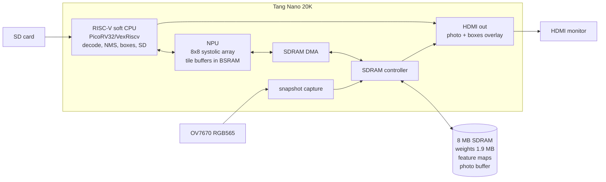

# Design Plan: YOLOv5n Trash Detector on a Custom NPU (Tang Nano 20K)

**Created:** 2026-10-23
**Author:** GateFlow Planner
**Status:** Draft (supersedes `vision_npu.md` as the project goal; that plan's Phases 0–1 are done and reused)

## Goal

Run a **YOLOv5n object detector, trained on the author's trash dataset**
([finn-freas/Trash_Detection](https://github.com/finn-freas/Trash_Detection)),
on a custom INT8 NPU built on a $30 Sipeed Tang Nano 20K. The board works
standalone: press a button and the camera takes a photo (or a test photo loads
from the SD card). About 0.5–3 s later the HDMI monitor shows the photo with a
labeled box around each piece of trash.

**Photo mode, not live video.** That trades frame rate for a real detector:
YOLOv5n is about 100× more compute than anything that would run at 30 fps on this chip.

> Resume line: *trained a YOLOv5 trash detector, then deployed it bit-exact
> (vs TFLite) on an NPU and compiler I designed, on a $30 FPGA.*

## What carries over from `vision_npu.md`

| Done | Reused as-is |
|------|--------------|
| HDMI output path (timing, TMDS, Gowin serializers), board constraints, build flow | ✅ |
| ISA as single source of truth → generated `npu_pkg.sv` | ✅ (extended) |
| TFLite-exact requant, including the conv = double / FC = single rounding finding | ✅ |
| IR exporter, compiler, NumPy ISA simulator, three-way golden check | ✅ (extended) |
| MNIST CNN | ✅ Kept as the **first bit-exact RTL milestone** (small, fast to simulate) |

## Model

| | Teacher (existing) | **Deployed** |
|---|---|---|
| Arch | YOLOv5s, SiLU | **YOLOv5n, ReLU** |
| Input | 640×640 RGB | **320×320 RGB** |
| Params | 7.2 M | ~1.8 M |
| Compute | ~8.2 G MAC | **~0.56 G MAC** |
| Weights | 14.5 MB fp16 | **~1.9 MB INT8** |
| Accuracy | mAP@0.5 = 0.717 | Measured after training (expect lower; reported honestly) |

Design choices:
- **ReLU instead of SiLU:** fuses into CONV as a clamp, with no extra op. The usual
  accuracy cost is ~1–2 mAP. A generic 256-entry **LUT** op stays on the list in
  case SiLU proves clearly better.
- **320×320:** keeps the largest feature map (160×160×16 = 400 KB) and the per-photo
  time manageable. 416 or 640 are later experiments.
- **Detect-head decode is not in the graph.** The NPU outputs the three raw head
  tensors (40×40, 20×20, 10×10 × 3 anchors × (5+nc)). The soft CPU thresholds
  objectness in the INT8 domain first, so only a few candidates need decoding, then
  runs sigmoid/grid/anchor decode and NMS.
- **Distillation from the YOLOv5s teacher** is optional, if plain YOLOv5n training falls short.

## Architecture changes vs. `vision_npu.md`

| Area | Change |
|------|--------|
| **Memory** | Weights and feature maps live in SDRAM. On-chip BSRAM becomes tile buffers (input band, output band, weight chunk), double-buffered. |
| **Tiling** | The compiler splits each layer into output-row bands that fit on-chip; DMA instructions move bands between SDRAM and BSRAM. |
| **ISA** | Add `DMA_LOAD` / `DMA_STORE`, `ADD` (residual, TFLite int8 ADD rescale), `CONCAT` (channel-block interleave copy), `UPSAMPLE2X` (nearest), `MAXPOOL` with padding (SPPF 5×5 s1 p2), optional `LUT`. Addresses widen to SDRAM's 23-bit word space. |
| **Program** | Hundreds of instructions after tiling, so the program lives in SDRAM and the NPU fetches it via DMA. |
| **Control** | A soft RISC-V CPU (RV32IM, ~2–3 K LUT) handles boot, SD-card loading (weights, program, test photos), camera snapshot, starting the NPU, decode + NMS, and the box/label overlay. |
| **Clocks** | NPU + SDRAM at ~63 MHz (rPLL), video at 25.2 MHz; the CPU shares the NPU clock. Async FIFOs / dual-clock RAM at the video and camera boundaries. |
| **Video** | Shows the stored photo (320×320, from SDRAM) scaled on screen, with boxes and labels drawn by the overlay from a CPU-written box list. |

## Milestones

| # | Milestone | Done when |
|---|-----------|-----------|
| **M0** | Dataset + training | YOLOv5n-ReLU-320 trained on the trash data; mAP reported vs the YOLOv5s teacher; INT8 TFLite exported, with its accuracy measured |
| **M1** | MNIST NPU in RTL sim (old Phases 2–4) | Full MNIST program bit-exact in RTL simulation |
| **M2** | YOLO in the NumPy simulator | Compiler handles YOLOv5n (tiling, new ops); `npu_sim` bit-exact vs TFLite on every layer; CPU-side decode + NMS in Python gives the same boxes as TFLite |
| **M3** | YOLO ops in RTL | ADD / CONCAT / UPSAMPLE / pool-with-pad / DMA, each bit-exact in cocotb |
| **M4** | SDRAM + DMA + tiled execution in RTL sim | YOLOv5n end-to-end bit-exact in RTL sim (with an SDRAM model) |
| **M5** | Soft CPU + firmware | Decode/NMS firmware gives identical boxes to Python; SD-card boot |
| **M6** | Synthesis + timing | Fits GW2AR-18; timing met at the chosen clocks |
| **M7** | Hardware bring-up | SD photo → boxes on HDMI, then camera snapshot mode |
| **M8** | Performance + write-up | Per-layer cycles, DMA vs compute roofline, optimizations with before/after numbers, README + demo video |

## Rough budgets (to be refined at M2)

| Resource | Estimate | Limit |
|----------|----------|-------|
| SDRAM | weights 1.9 MB + live feature maps ~1.5 MB + photo 300 KB + program < 0.1 MB ≈ 3.8 MB | 8 MB |
| SDRAM traffic / photo | ~10–20 MB | at ~200 MB/s effective ≈ 50–100 ms |
| Compute / photo | 0.56 G MAC; at 64 MAC × 63 MHz × ~30% ≈ 1.2 G MAC/s | ≈ 0.5 s, plus DMA stalls → target < 3 s |
| BSRAM | tile buffers ~24, CPU RAM ~8–12, video ~4 | 46 |
| LUT | NPU ~8 K, CPU ~3 K, SDRAM/DMA ~1.5 K, video ~1 K | 20.7 K |

## Risks

| ID | Risk | Prob. | Impact | Mitigation |
|----|------|-------|--------|------------|
| Y-1 | PyTorch → INT8 TFLite export of YOLOv5 (Keras 3 vs yolov5's TF port) | Med | High | Try yolov5 `export.py`, then onnx2tf, then ai-edge-torch; decide in M0 |
| Y-2 | Accuracy loss: n vs s, 320 vs 640, ReLU, INT8 | High | Med | Measure each step separately; distillation from YOLOv5s; 416 input if time allows |
| Y-3 | SDRAM controller on GW2AR's in-package SDRAM | Med | High | Start from a known open design; dedicated sim model + HW test early |
| Y-4 | BSRAM pressure (tile buffers + CPU + video) | Med | Med | Tile sizes are a compiler parameter; frame buffer in SDRAM |
| Y-5 | Scope: SDRAM + CPU + new ops is several times the MNIST design | High | High | Strict milestones; M1 and M2 are useful even if hardware stalls |
| Y-6 | TFLite rounding variants in ADD / CONCAT / etc. | Med | Med | Same per-op measurement method that found the conv/FC difference |

## Approval
- [x] Goal confirmed by user (YOLOv5 trash detector, photo mode, Tang Nano 20K)
- [ ] M0 dataset + training results reviewed
- [ ] Architecture details (tiling, ISA v2) reviewed at M2

---
*Generated by GateFlow Planner*
