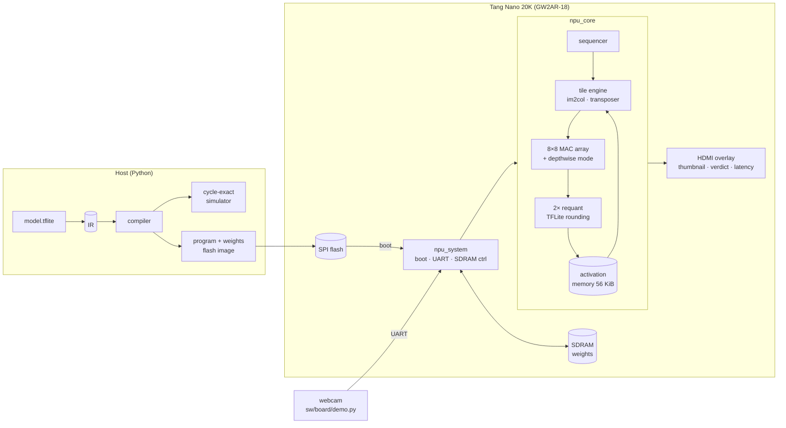

# deployed-cnn-fpga

[](https://github.com/finn-freas/deployed-cnn-fpga/actions/workflows/ci.yml)

This is a neural network accelerator (NPU) I designed, running a person detector on a $25
FPGA board (Sipeed Tang Nano 20K, Gowin GW2AR-18).

The model is the MLPerf Tiny Visual Wake Words model. It's a small MobileNet that looks at a
96x96 color image and says "person" or "no person". Everything is built with the
open-source tools (Yosys, nextpnr, Verilator, cocotb), no vendor IDE.

- one image takes 243,602 clock cycles, or 256,642 when the weights come from the board's
  SDRAM. At 54 MHz that's **4.75 ms per image**
- the main part is an 8x8 grid of multiply-accumulate units, and it uses 77% of the FPGA's
  logic
- the design passes timing at 64 MHz and runs at 54 MHz

Everything passes in simulation, including the whole board with models of the flash and
SDRAM. I'm testing it on the real board now ([docs/bringup.md](docs/bringup.md)).

## How it fits together



## How the NPU works

The model is quantized to 8-bit integers (int8), so all the math on the FPGA is integer math.
No floating point is needed.

The NPU runs the network one layer at a time, and each layer is one instruction. There are
only four instructions:

- **CONV**: a normal convolution. Fully connected layers are also done as a CONV.
- **DWCONV**: a depthwise convolution, where each channel gets its own filter. MobileNet
  uses a lot of these.
- **MAXPOOL**
- **ARGMAX**: picks the biggest output, which is the answer

Average pooling isn't its own instruction. The compiler turns it into a DWCONV where all the
weights are 1. The instruction format is in [docs/isa.md](docs/isa.md).

**Memory.** The image and the outputs of each layer (the feature maps) stay inside the FPGA
in a 56 KiB memory. The weights are too big for that, so at power-up they get copied from
the flash chip into the SDRAM, and each layer reads its weights from there while it runs.

**Getting the data ready.** A convolution looks at a small window of the input for every
output pixel. The "tile engine" reads these windows out of memory and lines them up for
the array. Work is split into jobs of 8 output pixels × 8 output channels.

**The MAC array.** This is an 8x8 grid of multiply-accumulate units. Each one multiplies an
input by a weight and adds the result to a running sum, so the 64 units together compute
8x8 outputs at once. When a job is done, every unit saves its sum in a spare register and
starts the next job right away, while the saved sums are read out.

**Depthwise layers.** For DWCONV the same array is used a bit differently. A job is 8
neighbouring pixels in one row × 8 channels, and each unit gets its input straight from
memory as it's read, so no extra buffer is needed.

**Back to int8.** After a layer, the sums are much bigger than 8 bits and need to be scaled
back down to int8 for the next layer. TensorFlow Lite does this with a specific integer multiply and
rounding, and I copied it exactly, so my results match TFLite bit for bit. Two of these
"requantizer" units run in parallel.

**Fitting it in.** The FPGA only has about 20K logic cells, so the design had to be small.
I avoided multipliers anywhere except the actual math, and put small tables in
LUT RAM. One thing specific to this FPGA: a register that's fed by another register costs an
extra logic cell, so I tried to avoid copying signals into extra registers.

## The compiler and simulator

`sw/model/export_ir.py` reads an int8 TFLite model and saves its layers in a simple format
(JSON + npz). Both models are already converted in [`models/ir`](models/ir), so you don't
need TensorFlow installed.

`sw/npu/compiler.py` turns that into a program for the NPU. It decides how the weights are
laid out, where each feature map goes in memory, and which rounding each layer needs.

`sw/npu/sim.py` is a simulator written in Python. It does the same integer math as the
hardware and also predicts how many clock cycles each instruction takes, which I use to
check the hardware.

```bash
cd sw && python -m npu.compiler ../models/ir/vww --out ../build/npu_vww
```

## Results

| Model | Cycles | Time at 54 MHz | Accuracy |
|-|-:|-:|-|
| MLPerf Tiny VWW (96x96x3, 29 layers, 7.5M multiply-adds) | 243,602 | 4.5 ms (4.75 ms from SDRAM) | same as TFLite int8 |
| MNIST CNN | 16,612 | 0.31 ms | same as TFLite int8 |

| Board build (`npu_board_top`) | |
|-|-|
| FPGA usage | LUT4 77%, DFF 55%, BSRAM 45/46, 64 DSP multipliers |
| Max clock after routing | 64.4 MHz for the NPU (runs at 54 MHz), 83.5 MHz for HDMI (runs at 25.2 MHz) |

The first version took 705k cycles per image. I got it down to 243k by overlapping work
that used to happen one step at a time (loading weights, reading out results, starting the
next job), adding the depthwise mode, and packing the RGB pixels of the first layer together.

## Running it on the board

For the first time, go through the [bring-up checklist](docs/bringup.md). There's a
test bitstream plus `sw/board/board_check.py` that check the UART, SDRAM and flash one at a
time before the NPU goes on.

```bash
make -C fpga/tangnano20k TOP=npu_board_top FREQ_MHZ=54        # bitstream (or grab it from CI)
make -C fpga/tangnano20k TOP=npu_board_top prog               # write it to flash
cd sw && python -m npu.board ../models/ir/vww --image photo.jpg --program   # model + demo image
python sw/board/demo.py --port COM5                           # webcam -> board -> verdict
```

At power-up the board copies the weights from flash into SDRAM and classifies the demo
image. After that, any image sent over the UART (1 Mbaud) gets classified. The HDMI output
shows the image, the verdict, the score, and latency.

## Building and testing

```bash
make env                 # .venv (simulation) and .venv-tf (TFLite export)
make test-sw             # ISA, requant, compiler and simulator tests
make test-rtl            # cocotb + Verilator (needs OSS CAD Suite in ~/oss-cad-suite)
```

The hardware tests check every layer's output against TFLite, check the cycle counts against
the simulator, run random small networks, and simulate the whole board. GitHub Actions runs
all of it and builds the bitstreams.

## Layout

```
rtl/npu/      the NPU: core, tile engine, MAC array, requant, pool
rtl/board/    board system: flash boot, SDRAM controller, UART, HDMI overlay, bring-up test
sw/npu/       ISA, compiler, simulator, TFLite-exact quantization, flash images
sw/board/     board check and webcam demo
sw/model/     model export (TFLite -> IR), training script
models/       the VWW and MNIST TFLite models and their IR
tb/           cocotb testbenches
fpga/         Tang Nano 20K constraints and build
docs/         ISA reference, bring-up checklist
```

## License

MIT, see [LICENSE](LICENSE). The MLPerf Tiny VWW model files in `models/vww/` are from
[mlcommons/tiny](https://github.com/mlcommons/tiny) (Apache License 2.0).
