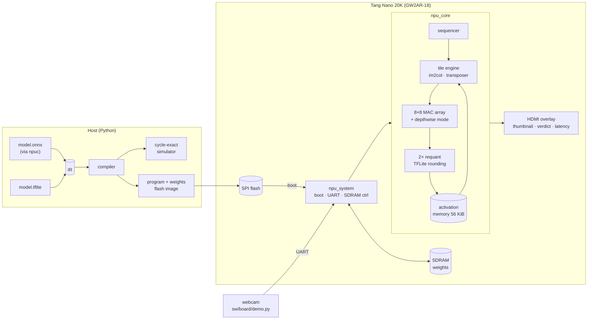

# deployed-cnn-fpga

[](https://github.com/finn-freas/deployed-cnn-fpga/actions/workflows/ci.yml)


[](LICENSE)

A custom INT8 neural-network accelerator and a person detector running on a
$25 FPGA board. The NPU runs the MLPerf Tiny Visual Wake Words model on a Sipeed Tang
Nano 20K, bit-exact with TensorFlow Lite. Everything is built with
open-source tools: Yosys, nextpnr, Verilator and cocotb. Quantized ONNX models are compiled
for it by [**npuc**](https://github.com/finn-freas/npuc), a separate repository.

|  |  |
|-|-|
| **Visual Wake Words** | 243,602 cycles (ideal memory), 256,642 from the board's SDRAM: **4.75 ms at 54 MHz** |
| **Accuracy** | identical to TFLite's int8 reference kernels, every layer, every tested image |
| **Compiler** | TFLite → NPU program, with a cycle-exact simulator; ONNX via [npuc](https://github.com/finn-freas/npuc) |
| **Hardware** | 8×8 MAC array, depthwise unit, 2 requantizers; 77% of the GW2AR-18's LUTs, 64 DSP multipliers |
| **Board** | boots from SPI flash, weights in SDRAM, images over USB-UART, result on HDMI |

## How it fits together



## The accelerator

- **ISA**: CONV (including the packed first layer and fully connected layers), DWCONV,
  MAXPOOL, ARGMAX. Average pooling and 1×1 depthwise layers are lowered by the compiler
  ([docs/isa.md](docs/isa.md)).
- **Output-stationary 8×8 array** with row skew only. Each PE latches its finished sum into
  a shadow register as a job's last value passes, so jobs stream back to back while the
  drain requantizes the previous one.
- **Depthwise mode without a line buffer**: the array works row-staggered, and each PE row
  uses exactly the word arriving from activation memory, one tap per read.
- **TFLite-exact requantization**: both of TFLite's rounding variants (double rounding for
  convolutions, single for fully connected) on one shared datapath, chosen per instruction.
- **Built for a 20K-LUT part**: no multipliers in address math (counters and shift-add),
  LUT-RAM transposer and parameter store, and designed around Gowin's register packing (a
  register fed by another register costs a pass-through LUT).

## The compiler

`sw/model/export_ir.py` turns an int8 TFLite model into a framework-free IR (committed for
the two models in [`models/ir`](models/ir)). `sw/npu/compiler.py` maps it onto the ISA:
weight layouts, padding, ping-pong placement in activation memory, average-pool lowering,
and the rounding mode per layer. `sw/npu/sim.py` executes the result with the RTL's
integer math and reproduces its cycle count per instruction.

```bash
cd sw && python -m npu.compiler ../models/ir/vww --out ../build/npu_vww
```

[**npuc**](https://github.com/finn-freas/npuc) adds an ONNX front end on top of this
(PyTorch / ONNX Runtime quantized models, checked layer by layer against ONNX Runtime).

## Results

| Model | Cycles | Latency at 54 MHz | Accuracy |
|-|-:|-:|-|
| MLPerf Tiny VWW (96×96×3, 29 layers, 7.5 M MACs) | 243,602 | 4.5 ms (4.75 ms from SDRAM) | = TFLite int8 |
| MNIST CNN (TFLite) | 16,612 | 0.31 ms | = TFLite int8 |
| MNIST CNN (PyTorch → ONNX, [npuc](https://github.com/finn-freas/npuc)) | 14,423 | 0.27 ms | 97.6%, = ONNX Runtime |

| Board design (`npu_board_top`) | |
|-|-|
| Utilisation | LUT4 77%, DFF 55%, BSRAM 45/46, 64 DSP multipliers |
| Fmax after routing | 62.9 MHz NPU domain (runs at 54 MHz), 91 MHz HDMI domain (runs at 25.2 MHz) |

The optimisation history (cycle-count reductions, the depthwise unit, place-and-route
fixes) is in [`.gateflow/plans/vww_npu_compiler.md`](.gateflow/plans/vww_npu_compiler.md).

## Running on the board

First time: follow the step-by-step [bring-up checklist](docs/bringup.md). A small
bring-up bitstream and `sw/board/board_check.py` check the UART, the SDRAM and the flash
one at a time, then compare the NPU's results on the board with the simulator.

```bash
make -C fpga/tangnano20k TOP=npu_board_top FREQ_MHZ=54        # bitstream (or download it from CI)
make -C fpga/tangnano20k TOP=npu_board_top prog               # write it to flash
cd sw && python -m npu.board ../models/ir/vww --image photo.jpg --program   # model + demo image
python sw/board/demo.py --port COM5                           # webcam -> board -> verdict
```

At power-up the board copies the weights from flash into SDRAM and classifies the demo image.
Images sent over the UART (1 Mbaud) are classified as they arrive. The HDMI output shows
the input, the verdict, the score and the latency. S1 resets, S2 reruns the demo image, and
the LEDs show person / no person / busy / booted / error.

## Getting started

```bash
make env                 # .venv (simulation) and .venv-tf (TFLite export)
make test-sw             # ISA, requant, compiler and simulator tests
make test-rtl            # cocotb + Verilator (needs OSS CAD Suite in ~/oss-cad-suite)
```

The RTL is checked against TFLite's golden tensors layer by layer, cycle by cycle against
the simulator's timing model, on random networks (odd sizes, strides, padding), and as a
whole board system with SPI flash and SDRAM models. CI runs all of it and builds the
bitstream.

## Layout

```
rtl/npu/      the NPU: core, tile engine, MAC array, requant, pool
rtl/board/    board system: flash boot, SDRAM controller, UART, HDMI overlay
sw/npu/       ISA, compiler, cycle-exact simulator, TFLite-exact quantization, flash images
sw/model/     model export (TFLite -> IR), training script
models/       the VWW and MNIST TFLite models and their exported IR
tb/           cocotb testbenches
fpga/         Tang Nano 20K constraints and build
docs/         ISA reference
```

## License

MIT, see [LICENSE](LICENSE). The MLPerf Tiny VWW model files in `models/vww/` come from
[mlcommons/tiny](https://github.com/mlcommons/tiny) under the Apache License 2.0.
