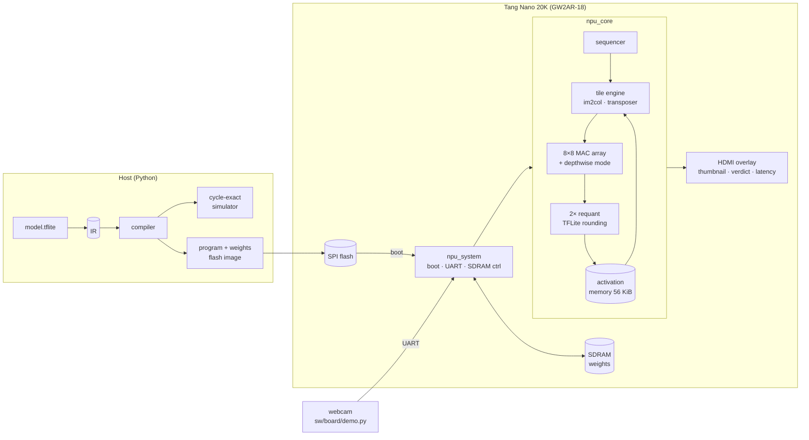

# deployed-cnn-fpga

[](https://github.com/finn-freas/deployed-cnn-fpga/actions/workflows/ci.yml)

My own INT8 neural network accelerator, running a person detector on a $25 FPGA board
(Sipeed Tang Nano 20K, Gowin GW2AR-18).

The model is the MLPerf Tiny Visual Wake Words reference (MobileNetV1 0.25, 96x96 RGB in,
"person" / "no person" out). The NPU's output matches TensorFlow Lite's int8 reference
kernels bit for bit, on every layer, not just the final class. Everything is built with the
open-source flow (Yosys, nextpnr, Verilator, cocotb), no vendor IDE.

Numbers so far:

- VWW: 243,602 cycles with ideal memory, 256,642 with weights coming from the board's SDRAM,
  so **4.75 ms per image at 54 MHz**
- 8x8 MAC array + depthwise mode + 2 requantizers, using 77% of the LUTs and 64 DSP multipliers
- board build closes at 64 MHz after routing (runs at 54)

Status: everything passes in simulation, including the whole board system with flash and
SDRAM models. The board just arrived, so hardware bring-up is in progress
([docs/bringup.md](docs/bringup.md)).

## How it fits together



## The hardware

The ISA is small: CONV (which also covers the packed first layer and fully connected
layers), DWCONV, MAXPOOL and ARGMAX. Average pooling and 1x1 depthwise layers get lowered by
the compiler. Details in [docs/isa.md](docs/isa.md).

Some design decisions:

- **Output-stationary 8x8 array** with only a row skew. Each PE copies its finished sum into
  a shadow register as the job's last value goes by, so the next job can start right away
  while the drain requantizes the previous one.
- **Depthwise without a line buffer.** In depthwise mode the array runs row-staggered and
  each PE row uses exactly the word that's arriving from activation memory, one tap per read.
  A line buffer didn't fit.
- **TFLite-exact requantization.** TFLite rounds twice for convolutions and once for fully
  connected layers; both variants share one datapath and the instruction picks which.
- **Fitting in 20K LUTs** was the hardest part. No multipliers in address math (counters and
  shift-add instead), LUT RAM for the transposer and parameter store. The non-obvious one:
  on Gowin a flip-flop can only take its input from the LUT in its own slice, so every
  register fed by another register costs a pass-through LUT that the utilisation report
  doesn't show. At one point the real demand was 21.4k of 20.7k LUT positions and the placer
  just spun, while the report looked fine. [docs/notes.md](docs/notes.md) has the whole story.

## The compiler and simulator

`sw/model/export_ir.py` converts an int8 TFLite model into a simple IR (JSON + npz, committed
for both models in [`models/ir`](models/ir), so you don't need TensorFlow).
`sw/npu/compiler.py` maps the IR onto the ISA: weight layouts, padding, where each feature
map goes in activation memory, average-pool lowering and the rounding mode per layer.
`sw/npu/sim.py` runs the program with the same integer math as the RTL and predicts the
cycle count of every instruction exactly.

```bash
cd sw && python -m npu.compiler ../models/ir/vww --out ../build/npu_vww
```

## Results

| Model | Cycles | Latency at 54 MHz | Accuracy |
|-|-:|-:|-|
| MLPerf Tiny VWW (96x96x3, 29 layers, 7.5M MACs) | 243,602 | 4.5 ms (4.75 ms from SDRAM) | = TFLite int8 |
| MNIST CNN | 16,612 | 0.31 ms | = TFLite int8 |

| Board build (`npu_board_top`) | |
|-|-|
| Utilisation | LUT4 77%, DFF 55%, BSRAM 45/46, 64 DSP multipliers |
| Fmax after routing | 64.4 MHz NPU clock (runs at 54 MHz), 83.5 MHz HDMI clock (runs at 25.2 MHz) |

VWW started at 705k cycles. How it got to 243k (and what I tried that didn't fit) is in
[docs/notes.md](docs/notes.md).

## Running it on the board

For the first time, go through the [bring-up checklist](docs/bringup.md). There's a small
test bitstream plus `sw/board/board_check.py` that check the UART, SDRAM and flash one at a
time before the NPU goes on.

```bash
make -C fpga/tangnano20k TOP=npu_board_top FREQ_MHZ=54        # bitstream (or grab it from CI)
make -C fpga/tangnano20k TOP=npu_board_top prog               # write it to flash
cd sw && python -m npu.board ../models/ir/vww --image photo.jpg --program   # model + demo image
python sw/board/demo.py --port COM5                           # webcam -> board -> verdict
```

At power-up the board copies the weights from flash into SDRAM and classifies the demo
image. After that, any image sent over the UART (1 Mbaud) gets classified. The HDMI output
shows the image, the verdict, the score and the latency. S1 resets, S2 reruns the demo image.

## Building and testing

```bash
make env                 # .venv (simulation) and .venv-tf (TFLite export)
make test-sw             # ISA, requant, compiler and simulator tests
make test-rtl            # cocotb + Verilator (needs OSS CAD Suite in ~/oss-cad-suite)
```

The RTL tests compare against TFLite's tensors layer by layer and against the simulator's
cycle counts, run random networks (odd sizes, strides, padding), and simulate the whole board
system with SPI flash and SDRAM models. CI runs all of it and builds the bitstreams.

## Layout

```
rtl/npu/      the NPU: core, tile engine, MAC array, requant, pool
rtl/board/    board system: flash boot, SDRAM controller, UART, HDMI overlay, bring-up test
sw/npu/       ISA, compiler, cycle-exact simulator, TFLite-exact quantization, flash images
sw/board/     board check and webcam demo
sw/model/     model export (TFLite -> IR), training script
models/       the VWW and MNIST TFLite models and their IR
tb/           cocotb testbenches
fpga/         Tang Nano 20K constraints and build
docs/         ISA reference, bring-up checklist, design notes
```

## License

MIT, see [LICENSE](LICENSE). The MLPerf Tiny VWW model files in `models/vww/` are from
[mlcommons/tiny](https://github.com/mlcommons/tiny) (Apache License 2.0).
