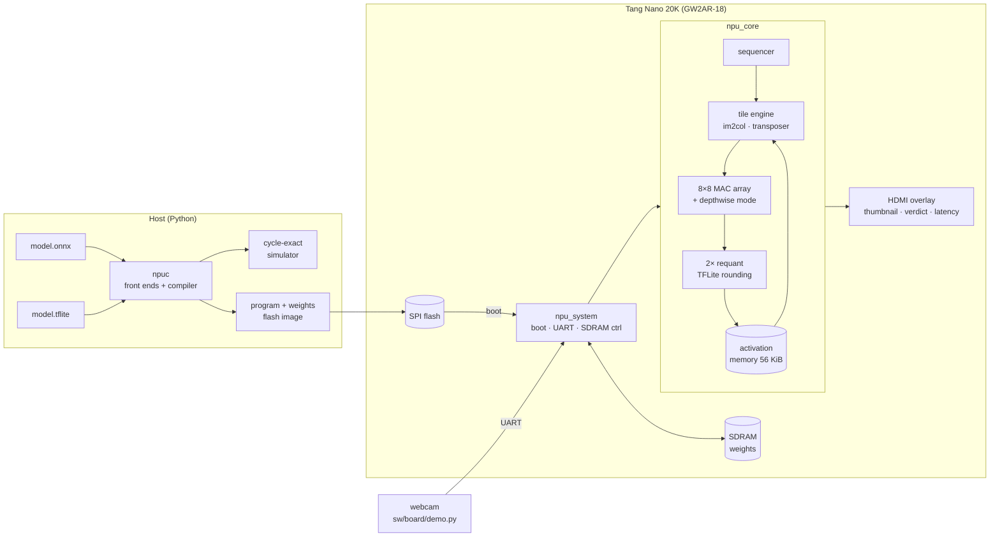

# deployed-cnn-fpga

[](https://github.com/finn-freas/deployed-cnn-fpga/actions/workflows/ci.yml)


**A custom INT8 neural-network accelerator, its compiler, and a person detector running on a
$25 FPGA board.** The NPU runs the MLPerf Tiny **Visual Wake Words** model on a Sipeed Tang
Nano 20K, **bit-exact with TensorFlow Lite**, in about **5 ms per image**. `npuc` compiles
quantized ONNX models for it. Everything is built with open-source tools: Yosys,
nextpnr, Verilator and cocotb.

|  |  |
|-|-|
| **Visual Wake Words** | 258,808 cycles (ideal memory), ~273k from the board's SDRAM: **5.1 ms at 54 MHz** |
| **Accuracy** | identical to TFLite's int8 reference kernels, every layer, every tested image |
| **Compiler** | `npuc`: ONNX (QDQ / QOperator) or TFLite → NPU program, checked against ONNX Runtime |
| **Hardware** | 8×8 MAC array, depthwise unit, 2 requantizers; 76% of the GW2AR-18's LUTs, 64 DSP multipliers |
| **Board** | boots from SPI flash, weights in SDRAM, images over USB-UART, result on HDMI |

## How it fits together



## The accelerator

- **ISA**: CONV (including the packed first layer and fully connected layers), DWCONV,
  MAXPOOL, ARGMAX. Average pooling and 1×1 depthwise layers are lowered by the compiler
  ([docs/isa.md](docs/isa.md)).
- **Output-stationary 8×8 array** with row skew only. Each PE latches its finished sum into
  a shadow register as a job's last value passes, so jobs stream back to back while the
  drain requantizes the previous one.
- **Depthwise mode without a line buffer**: the array works row-staggered, and each PE row
  uses exactly the word arriving from activation memory, one tap per read.
- **TFLite-exact requantization**: both of TFLite's rounding variants (double rounding for
  convolutions, single for fully connected) on one shared datapath, chosen per instruction.
- **Built for a 20K-LUT part**: no multipliers in address math (counters and shift-add),
  LUT-RAM transposer and parameter store, and designed around Gowin's register packing (a
  register fed by another register costs a pass-through LUT).

## npuc: the compiler

```bash
cd sw
python -m npuc ../models/onnx/mnist_cnn_int8.onnx --images ../models/onnx/mnist_test.npz --verify 1000
```

`npuc` maps a quantized ONNX classifier onto the NPU, writes the memory images and a board
flash image, and reports per-layer cycles. It also runs the program in the simulator and
compares every layer's output with ONNX Runtime:

```
| Latency | 14,423 cycles = 0.27 ms at 54 MHz (ideal memory) |
Check against ONNX Runtime (1000 images): class agrees on 1000/1000; 16617992/16618000 layer
outputs identical (100.000%), max difference 1 LSB. Accuracy: NPU 0.9760, ONNX Runtime 0.9760.
```

It accepts QDQ and QOperator models with int8 or uint8 activations (what
`onnxruntime.quantization` produces), and refuses unsupported models with a reason. The VWW
model converted with `tf2onnx` compiles to exactly the same images as the TFLite path. See
[docs/npuc.md](docs/npuc.md).

## Results

| Model | Cycles | Latency at 54 MHz | Accuracy |
|-|-:|-:|-|
| MLPerf Tiny VWW (96×96×3, 29 layers, 7.5 M MACs) | 258,808 | 4.8 ms (5.1 ms from SDRAM) | = TFLite int8 |
| MNIST CNN (TFLite) | 16,690 | 0.31 ms | = TFLite int8 |
| MNIST CNN (PyTorch → ONNX, `npuc`) | 14,423 | 0.27 ms | 97.6%, = ONNX Runtime |

| Board design (`npu_board_top`) | |
|-|-|
| Utilisation | LUT4 76%, DFF 56%, BSRAM 45/46, 64 DSP multipliers |
| Fmax after routing | 64.4 MHz NPU domain (runs at 54 MHz), 99 MHz HDMI domain (runs at 25.2 MHz) |

The optimisation history (cycle-count reductions, the depthwise unit, place-and-route
fixes) is in [`.gateflow/plans/vww_npu_compiler.md`](.gateflow/plans/vww_npu_compiler.md).

## Running on the board

```bash
make -C fpga/tangnano20k TOP=npu_board_top FREQ_MHZ=54        # bitstream (or download it from CI)
make -C fpga/tangnano20k TOP=npu_board_top prog               # write it to flash
cd sw && python -m npu.board ../build/vww --image photo.jpg --program   # model + demo image
python sw/board/demo.py --port COM5                           # webcam -> board -> verdict
```

At power-up the board copies the weights from flash into SDRAM and classifies the demo image.
Images sent over the UART (1 Mbaud) are classified as they arrive. The HDMI output shows
the input, the verdict, the score and the latency. S1 resets, S2 reruns the demo image, and
the LEDs show person / no person / busy / booted / error.

## Getting started

```bash
make env                 # .venv (simulation, npuc) and .venv-tf (TFLite export)
make test-sw             # compiler, simulator and npuc tests
make test-rtl            # cocotb + Verilator (needs OSS CAD Suite in ~/oss-cad-suite)
make npuc ONNX=path/to/model.onnx
```

The RTL is checked against TFLite's golden tensors layer by layer, cycle by cycle against
the simulator's timing model, on random networks (odd sizes, strides, padding), on
npuc-compiled ONNX models, and as a whole board system with SPI flash and SDRAM models. CI
runs all of it and builds the bitstream.

## Layout

```
rtl/npu/      the NPU: core, tile engine, MAC array, requant, pool
rtl/board/    board system: flash boot, SDRAM controller, UART, HDMI overlay
sw/npu/       ISA, compiler, cycle-exact simulator, TFLite-exact quantization, flash images
sw/npuc/      npuc: ONNX front end, verification against ONNX Runtime, CLI
sw/model/     model export (TFLite -> IR), training scripts (TF and PyTorch)
models/       the VWW and MNIST models (TFLite and ONNX)
tb/           cocotb testbenches
fpga/         Tang Nano 20K constraints and build
docs/         ISA and npuc reference
```
