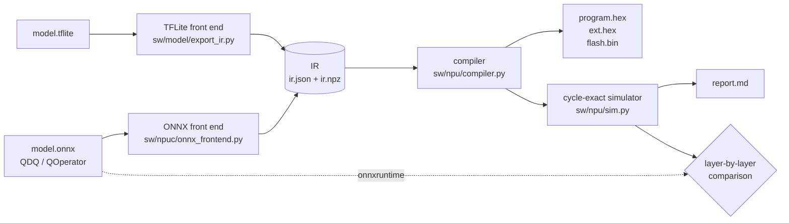

# npuc: ONNX → NPU compiler

`npuc` takes a quantized image classifier (ONNX, or TFLite) and produces everything the
NPU needs: the program, the weight/parameter image for flash or SDRAM, a board flash image,
and a report with per-layer cycle counts. It then runs the result in the cycle-exact
simulator and compares every layer with ONNX Runtime.

```bash
cd sw
python -m npuc ../models/onnx/mnist_cnn_int8.onnx --images ../models/onnx/mnist_test.npz --verify 1000
```

```
| Latency | 14,423 cycles = 0.27 ms at 54 MHz (ideal memory) |
| Work | 0.24 M MACs, 16.9 MAC/cycle (26% of the 8x8 array) |
...
Check against ONNX Runtime (1000 images): class agrees on 1000/1000; 16617992/16618000 layer
outputs identical (100.000%), max difference 1 LSB. Accuracy on the labels: NPU 0.9760,
ONNX Runtime 0.9760.

| # | Layer    | Source node            | NPU              | Shape (HxWxC)        | MACs    | Cycles | %    |
| 0 | L0_conv  | /0/Conv                | CONV             | 28x28x1 -> 14x14x16  | 28,224  | 2,030  | 14.1 |
| 1 | L1_dwconv| /2/Conv                | DWCONV           | 14x14x16 -> 14x14x16 | 28,224  | 2,056  | 14.3 |
...
| 7 | L7_avgpool | /14/GlobalAveragePool | DWCONV (uniform) | 3x3x64 -> 1x1x64    | 576     | 346    | 2.4  |
```

## Pipeline



The front ends map their format to one intermediate representation, so the compiler,
simulator, RTL tests and board tools are shared. The TFLite path is bit-exact with TFLite's
reference kernels. The ONNX path is checked against ONNX Runtime.

## Options

| Option | |
|-|-|
| `-o DIR` | output directory (default `build/npuc/<model name>`) |
| `--verify N` | compare N images with ONNX Runtime, layer by layer (default 10, `0` skips) |
| `--images X` | `.npz` with `images` (NHWC uint8) and optional `labels`, an image file, or a directory of images; default random pixels |
| `--rounding onnx\|tflite` | requant rounding (see below) |
| `--flash-image IMG` | also write `flash.bin`, a board flash image with this demo picture |

Outputs: `program.hex`, `ext.hex` (`$readmemh` images), `program.txt` (disassembly),
`meta.json` (memory map), `ir.json`/`ir.npz`, `report.md`, and `flash.bin`.
`python -m npu.board DIR --image photo.jpg --program` writes a board image from the
output directory.

## What it accepts

Sequential int8 classifiers (one image input, one class output), quantized with
`onnxruntime.quantization.quantize_static` (or another tool producing the same operators):

| ONNX | NPU | Limits |
|-|-|-|
| `Conv` | CONV | square kernel, equal strides, top padding = left padding, no dilation; input channels ≤ 7 for the first layer |
| `Conv` with `group = channels` | DWCONV | depthwise multiplier 1, kernel 2–3, stride 1–2 (a 1×1 depthwise becomes a CONV) |
| `Gemm`, `MatMul` (+ `Add` bias) | CONV over the whole map | after `Flatten`/`Reshape`; square map |
| `MaxPool` | MAXPOOL | needs a bitstream with the pool unit (the board build leaves it out) |
| `AveragePool`, `GlobalAveragePool` | DWCONV (≤ 3×3) or CONV (larger) | windows inside the input (no padding) |
| `Relu`, `Clip` | output clamp | fused into the layer before |
| `Softmax` (last op) | dropped | argmax is unchanged; the NPU returns logits |
| `QLinearConv`, `QLinearMatMul`, `QGemm`, `QLinearAveragePool`, `QLinearGlobalAveragePool` | as above | QOperator format |

Quantization:
- weights symmetric int8 (per channel or per tensor);
- activations int8 or uint8, per tensor (uint8 is mapped to int8 exactly);
- input codes must equal the raw pixels: train and calibrate with `x = pixel / 255`
  (uint8 zero point 0, scale 1/255), not mean/std normalization;
- inputs are NCHW, or NHWC followed by a transpose (as `tf2onnx` produces).

The first layer must be a convolution (it reads the packed pixels) and the network must
end in a 1×1×classes tensor. Hardware limits checked by the compiler: reduction length K ≤ 1024 per output (k·k·C),
≤ 256 output channels per layer, 56 KiB activation memory (two consecutive feature maps
must fit together), 512 KiB weight store, 64 instructions.

Anything else stops with a reason, for example:

```
npuc: resnet.onnx: unsupported model: tensor 'x' feeds 2 nodes (Conv, Add): only sequential
networks are supported (no residual connections, concatenation or multiple heads)
```

## Rounding

ONNX requantizes in floating point with round-half-to-even. The NPU's requantizer is
TFLite's fixed-point multiplier, in one of two modes per layer:

- `--rounding onnx` (default for `.onnx`): single rounding, one rounding of `acc × scale`,
  wherever the scale is below 1 (always, in practice). It differs from ONNX Runtime only on
  exact ties and through the 31-bit multiplier. On the test networks every layer output is
  identical. On MNIST, 8 of 16.6 million values differ, by 1 LSB.
- `--rounding tflite`: TFLite's per-op rounding (double rounding for convolutions). Use it
  for models converted from TFLite: `models/vww/vww_96_int8.onnx` (the VWW model run through
  `tf2onnx`) then compiles to the same images as the TFLite path, bit-exact with TFLite.

## Examples

- `models/onnx/mnist_cnn_int8.onnx`: a small MobileNet-style CNN trained in PyTorch
  (`sw/model/make_onnx_mnist.py`), quantized with ONNX Runtime: 97.6% accuracy, 0.27 ms.
- `models/vww/vww_96_int8.onnx`: MLPerf Tiny Visual Wake Words, 258,808 cycles (4.8 ms at
  54 MHz, ideal memory).

```bash
python -m npuc ../models/vww/vww_96_int8.onnx --rounding tflite --flash-image cat.jpg
```

## Tests

- `sw/tests/test_npuc.py`: three networks × {QDQ, QOperator} × {uint8, int8} against ONNX
  Runtime, MNIST accuracy, VWW equivalence with the TFLite path, rejected models, the CLI.
- `tb/test_npu_onnx.py`: npuc-compiled models on the RTL (Verilator), every layer and every
  instruction's cycle count equal to the simulator.
